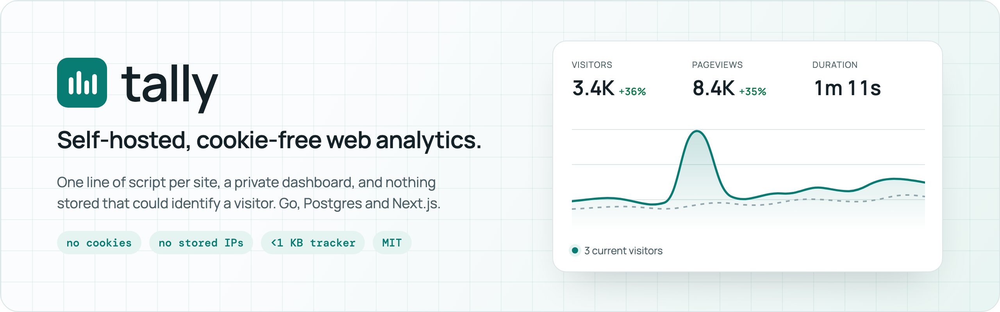
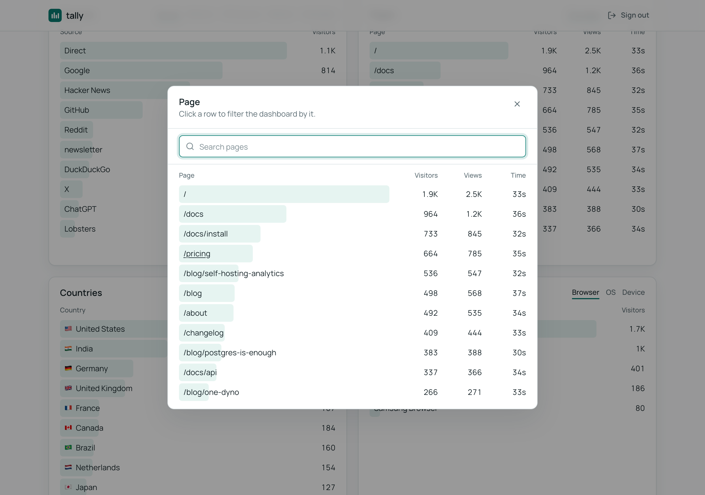
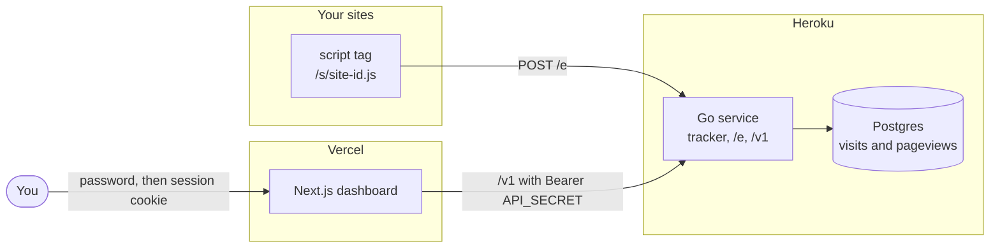
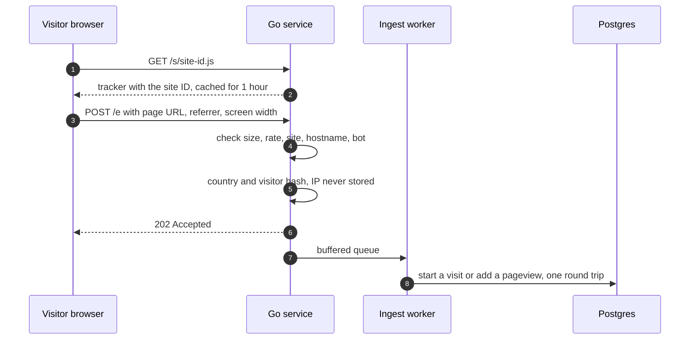

<p align="center">
  <picture>
    <source media="(prefers-color-scheme: dark)" srcset="docs/assets/banner-dark.png">
    
  </picture>
</p>

<p align="center">
  <a href="https://github.com/Gitax18/tally/actions/workflows/ci.yml"></a>
  <a href="LICENSE"></a>
  
  
  
  <br>
  
  
  
  <a href="#deployment"></a>
  <a href="#contributing"></a>
</p>

<p align="center">
  <a href="#features">Features</a> &nbsp;&middot;&nbsp;
  <a href="#quick-start">Quick start</a> &nbsp;&middot;&nbsp;
  <a href="#deployment">Deployment</a> &nbsp;&middot;&nbsp;
  <a href="#usage">Usage</a> &nbsp;&middot;&nbsp;
  <a href="#security-considerations">Security</a> &nbsp;&middot;&nbsp;
  <a href="#roadmap">Roadmap</a> &nbsp;&middot;&nbsp;
  <a href="#contributing">Contributing</a>
</p>

> *Analytics should tell you what you need to know about your site, not what anyone could learn
> about your visitors.*

**tally** is a small, self-hosted web analytics tool for people who run a handful of sites and
want honest numbers without Google Analytics, a monthly SaaS bill, or a cookie banner. Each site
gets one script tag. A private dashboard shows visitors, pages, sources, countries and devices,
each compared with the previous period. The data lives in your own Postgres database, and nothing
in it can identify a person.

It is deliberately boring technology: one Go binary, plain Postgres, and a Next.js dashboard. On
Heroku and Vercel the whole thing costs about $12 a month for any number of sites.

<picture>
  <source media="(prefers-color-scheme: dark)" srcset="docs/screenshots/dashboard-dark.png">
  
</picture>

## Contents

- [At a glance](#at-a-glance)
- [Why tally](#why-tally)
- [Features](#features)
- [How it works](#how-it-works)
- [Quick start](#quick-start)
- [Deployment](#deployment)
- [Usage](#usage)
- [Configuration](#configuration)
- [API](#api)
- [Security considerations](#security-considerations)
- [Privacy](#privacy)
- [Roadmap](#roadmap)
- [Development](#development)
- [Contributing](#contributing)
- [FAQ](#faq)
- [Acknowledgements](#acknowledgements)
- [License](#license)

## At a glance

| | |
|---|---|
| **Tracker** | 807 bytes gzipped, hand-written ES2017, no dependencies, no cookies |
| **Service** | One Go binary: serves the tracker, collects events, answers the stats API, runs retention |
| **Storage** | Plain Postgres: one row per visit and one per pageview, no ClickHouse, Redis or queue |
| **Dashboard** | Next.js 16 with server components; one admin password; light and dark themes |
| **Hosting** | Heroku (one Basic dyno, Essential-0 Postgres) and Vercel Hobby: about $12 a month |
| **Scale** | Built for up to roughly a million pageviews a month across all your sites |
| **Privacy** | Daily-rotating, per-site visitor hashes; IP addresses are never written down |
| **License** | MIT |

## Why tally

Most analytics tools either follow people around or charge by traffic. If all you want to know is
how many people read your projects, where they came from and which pages they liked, both are more
than you need.

| | Cookie-based analytics | Hosted privacy-first analytics | tally |
|---|---|---|---|
| Cookies or device storage | Yes | No | No |
| Consent banner usually needed | Yes | No | No |
| Where the data lives | The vendor's servers | The vendor's servers | Your own Postgres |
| Cost | Free, paid with your visitors' data | A subscription that grows with traffic | Your hosting bill, about $12 a month |
| Can be read, changed or extended | No | Varies | Yes, MIT-licensed |

tally does less than either. It has no funnels, heatmaps, session recordings or user profiles, and
it never will: the privacy guarantees come from not collecting what those features need.

## Features

### Tracking

- **One line per site**, with the site's ID built into the script URL, so the tag needs no
  attributes or configuration.
- **Single-page apps work out of the box**: the script follows `pushState`, `replaceState` and
  `popstate`.
- **Engaged time, not wall-clock time.** Time is counted only while the tab is visible and is
  reported when the page is hidden, left, or replaced by an SPA navigation.
- **Campaigns** from `utm_source`, `utm_medium`, `utm_campaign` and `ref`. Every other query
  parameter and the `#hash` are stripped before anything is sent.
- **Ignores what it should**: `localhost` (unless the site is `localhost`), automated browsers,
  known bots and crawlers, and your own browser after one visit with `?tally=ignore`.
- **No CORS preflight.** Events go out with `sendBeacon` as `text/plain`, one request each.

### Dashboard

- **Six metrics**, each with its change against the previous period: unique visitors, visits,
  pageviews, views per visit, bounce rate and visit duration.
- **A chart of any metric** with the previous period as a dashed line, hourly, daily or monthly.
- **Periods**: today, yesterday, last 7 and 30 days, this month, last month, last 12 months, and a
  custom range. Every number is in the site's own time zone.
- **Four panels** with tabs: sources (source, referrer, UTM source, medium, campaign), pages (top,
  entry, exit, with time on page), countries, and devices (browser, OS, device type). Each has a
  searchable details view.
- **Click to filter.** Any row becomes a filter chip, and filters combine.
- **Current visitors**, refreshed every 30 seconds.
- **Everything is in the URL**, so any view can be bookmarked or shared with yourself, and the back
  button works.

### Sites and operations

- Any number of sites, each with a name, domain (subdomains included) and time zone.
- A live "waiting for the first event" check right after adding a site.
- A storage meter that warns at 80%, because Heroku's Essential databases stop accepting writes when
  they are full.
- Automatic retention (24 months by default) and graceful shutdown that writes every queued event
  before the process exits.

<details>
<summary><b>More screenshots</b></summary>
<br>

| Filtered to one source | Details with search | Sites and storage |
|---|---|---|
|  |  |  |

</details>

## How it works



The Go service serves the tracking script itself. That keeps the script and the event endpoint on
one origin, lets the service see the visitor's real address (for the country and the visitor hash,
after which it is dropped), and lets it write the site ID into the script so the tag stays one
line. The dashboard never connects to Postgres; it asks the service, server to server, with a
shared secret that never reaches a browser.



A few decisions worth knowing about:

1. **One worker owns all visit state.** Events are answered with `202` immediately and queued; a
   single goroutine resolves visits (30 minutes of inactivity ends one) and writes them, so two
   events from the same visitor can never race. After a restart it picks visits back up from the
   database.
2. **Visit attributes are copied onto every pageview row.** Any breakdown with any filter is then a
   single-table query, with no joins.
3. **Time zones are handled in Postgres and Go together.** Buckets are grouped in the site's zone,
   gaps are filled in Go, and a running period is compared with the same elapsed slice of the
   previous one ("today until 2 pm" against "yesterday until 2 pm").

The exact definition of every number is in [docs/metrics.md](docs/metrics.md).

## Quick start

Run the whole stack locally with fake data in a few minutes.

**You need:** Go 1.27 or newer, Node 24 or newer with pnpm (`corepack enable`), Docker, and
`make`.

```sh
git clone https://github.com/Gitax18/tally.git
cd tally

make db migrate seed          # Postgres on 127.0.0.1:5442, the schema, and a "Demo" site with 90 days of visits
make run                      # the service on http://127.0.0.1:8090
```

In a second terminal:

```sh
cd web && pnpm install && cd ..
make web-dev                  # the dashboard on http://localhost:3010
```

Open <http://localhost:3010> and sign in with the development password `tally-dev-password`.

> [!TIP]
> To watch real events arrive, add a site with the domain `localhost`, serve the example pages with
> `python3 -m http.server 8099 -d examples`, and open
> `http://localhost:8099/demo.html?site=<site id>&api=http://127.0.0.1:8090`. The demo has links
> between pages and buttons that navigate like a single-page app.

## Deployment

tally runs as two pieces. Deploy the service first, then the dashboard.

| Piece | Where | Plan | Cost per month |
|---|---|---|---|
| Service (tracker, collector, API) | Heroku | One Basic dyno | $7 |
| Database | Heroku Postgres | Essential-0 (1 GB, about 2 million pageviews) | $5 |
| Dashboard | Vercel | Hobby | $0 |

Prices change; check Heroku's before you sign up.

| The service | The dashboard |
|---|---|
| [](https://www.heroku.com/deploy?template=https://github.com/Gitax18/tally) | [](https://vercel.com/new/clone?repository-url=https%3A%2F%2Fgithub.com%2FGitax18%2Ftally&root-directory=web&project-name=tally-dashboard&env=API_URL,API_SECRET,SESSION_SECRET&envDescription=API_URL%20is%20the%20service%27s%20public%20URL%2C%20API_SECRET%20the%20same%20value%20as%20on%20Heroku%2C%20SESSION_SECRET%20any%2032%2B%20random%20characters&envLink=https%3A%2F%2Fgithub.com%2FGitax18%2Ftally%2Fblob%2Fmain%2Fdocs%2Fself-hosting.md%233-deploy-the-dashboard-to-vercel) |

In outline:

1. **Hash your dashboard password:** `go run github.com/Gitax18/tally/cmd/server@latest hash-password`.
2. **Deploy the service** with the Heroku button (it adds Postgres, generates `API_SECRET`, and
   asks for the hash). Database migrations run automatically on every release.
3. **Give it your own domain**, such as `a.example.com`. Ad blockers often block analytics on
   `*.herokuapp.com`; a neutral subdomain of yours avoids most of that.
4. **Deploy the dashboard** with the Vercel button, with `API_URL` set to that domain, the same
   `API_SECRET`, and a random `SESSION_SECRET`.
5. **Add a site** in the dashboard and paste the snippet into your pages.

> [!IMPORTANT]
> Set the dashboard's `API_URL` to the service's public custom domain, not its `herokuapp.com`
> address. The snippet the dashboard shows you is built from it.

The full walkthrough, including the CLI route, the Vercel function region, backups, upgrades,
troubleshooting and hosting outside Heroku and Vercel, is in
**[docs/self-hosting.md](docs/self-hosting.md)**.

## Usage

### Add the snippet

Paste the line from the dashboard into the `<head>` of every page, for example in your base
template or root layout:

```html
<script defer src="https://a.example.com/s/k3j9x2a0bq.js"></script>
```

That is all. Single-page apps need nothing extra, and the script never delays your page: it is
deferred, cached for an hour, and smaller than most favicons.

### Tag your links

Campaign parameters decide a visit's source before the referrer does, so tagged links are counted
correctly even from apps and email clients that send no referrer:

```text
https://example.com/launch?utm_source=newsletter&utm_medium=email&utm_campaign=november
https://example.com/?ref=producthunt
```

Common spellings are merged, so `utm_source=google`, `google.de` and the Google app are all
"Google", and `t.co`, `x.com` and `twitter.com` are all "X".

### Exclude yourself

Open any page of your site once with `?tally=ignore`. That browser is no longer counted, on that
site, until you open a page with `?tally=track`.

### Content-Security-Policy

If your site sends a CSP header, allow the service's origin for the script and for the beacon:

```text
script-src 'self' https://a.example.com; connect-src 'self' https://a.example.com
```

### Read the numbers

The dashboard is the main way in, but the same data is available as JSON. See [API](#api).

## Configuration

### Service (Heroku)

| Variable | Default | Description |
|---|---|---|
| `DATABASE_URL` | set by the add-on | Postgres connection URL |
| `API_SECRET` | required | Shared secret for `/v1`. At least 32 characters of letters, digits, `-` and `_` |
| `ADMIN_PASSWORD_HASH` | required | Output of `hash-password` |
| `RETENTION_MONTHS` | `24` | Data older than this is deleted daily (1 to 120) |
| `DB_LIMIT_MB` | `1024` | Your database plan's limit, for the storage meter |
| `GEOIP_DOWNLOAD` | `true` | Download DB-IP's free country database at startup |
| `GEOIP_PATH` | | Use this local `.mmdb` file instead |
| `TRUST_PROXY` | `true` on Heroku | Take the client address from the last `X-Forwarded-For` entry |
| `LOG_LEVEL` | `info` | `debug`, `info`, `warn` or `error` |
| `SHUTDOWN_TIMEOUT` | `25s` | How long to drain queued events on shutdown |

### Dashboard (Vercel)

| Variable | Description |
|---|---|
| `API_URL` | The service's public URL, for example `https://a.example.com` |
| `API_SECRET` | The same value as the service's |
| `SESSION_SECRET` | 32 or more random characters (`openssl rand -hex 32`); signs the login cookie |
| `TRUST_FORWARDED_FOR` | Only outside Vercel, behind a proxy: use `X-Forwarded-For` for the sign-in rate limit |

## API

Everything the dashboard shows comes from a small JSON API on the service. Send
`Authorization: Bearer $API_SECRET` with every request.

| Method and path | Returns |
|---|---|
| `GET /v1/sites` | Every site |
| `POST /v1/sites` | A new site, from `name`, `domain` and `timezone` |
| `GET` `PATCH` `DELETE /v1/sites/{id}` | One site |
| `GET /v1/sites/{id}/summary` | The six metrics, the previous period's, and the change |
| `GET /v1/sites/{id}/timeseries` | Every metric per bucket (`interval`: `hour`, `day`, `month`), with the previous period |
| `GET /v1/sites/{id}/breakdown` | Top values of a `dimension`, with `limit` (1 to 1000) and `search` |
| `GET /v1/sites/{id}/realtime` | Visitors in the last 5 minutes |
| `GET /v1/usage` | Database size against `DB_LIMIT_MB`, and ingest counters |
| `GET /v1/timezones` | The time zones a site can use |

The stats endpoints take a `period` (`today`, `yesterday`, `7d`, `30d`, `month`, `last_month`,
`12mo`, or `custom` with `from` and `to` as `YYYY-MM-DD`) and optional `filters` such as
`source:Google,country:IN`, with each value URL-encoded. Filterable dimensions are `source`,
`referrer`, `utm_source`, `utm_medium`, `utm_campaign`, `page`, `entry_page`, `exit_page`,
`country`, `browser`, `os`, `device` and `hostname`.

```sh
curl -s -H "Authorization: Bearer $API_SECRET" \
  "https://a.example.com/v1/sites/k3j9x2a0bq/summary?period=30d"
```

```json
{
  "period": { "name": "30d", "from": "2026-10-28T00:00:00+01:00", "to": "2026-11-27T00:00:00+01:00" },
  "current": {
    "visitors": 3413, "visits": 4001, "pageviews": 8443,
    "views_per_visit": 2.11, "bounce_rate": 46.7, "visit_duration": 70.8
  },
  "change": { "visitors": 35.8, "visits": 35.4, "pageviews": 35.3, "bounce_rate": -1 }
}
```

The response above is shortened. Durations are in seconds, rates in percent, and the bounce rate's
change in percentage points.

## Security considerations

tally has a small attack surface on purpose: two public endpoints for the tracker, and a private
API that only the dashboard's server calls. This is what protects each part.

| Area | Protection |
|---|---|
| Dashboard sign-in | One password, stored only as a scrypt hash (N = 2^15, r = 8, p = 1, random 16-byte salt) and checked by the service. 5 attempts per minute per address |
| Dashboard session | A signed (HS256) token in an `httpOnly`, `SameSite=Lax` cookie, `Secure` in production, valid for 30 days. Every page except `/login` and every API route checks it |
| Dashboard to service | `Bearer API_SECRET`, at least 32 characters, compared in constant time. Calls are server to server; the secret never reaches a browser |
| Browser hardening | A per-request Content-Security-Policy with a nonce and `strict-dynamic`, `frame-ancestors 'none'`, `X-Frame-Options: DENY`, `nosniff`, a same-origin referrer policy and opener policy, and `noindex` |
| Event intake | Bodies over 2 KB are refused; at most 30 requests per 10 seconds per address (per /64 for IPv6); the site must exist; the page's hostname must be the site's domain or a subdomain; known bots are dropped; only `http` and `https` URLs |
| Client address | On Heroku, the last `X-Forwarded-For` entry, which the router appends. Earlier entries are set by the client and are ignored |
| Database queries | Dimensions map to fixed, whitelisted column names. Filter and search values only ever reach SQL as bind parameters |
| Errors | Internal errors are logged and answered with a generic message |
| Data minimisation | No IP addresses, user agent strings or cookies are stored; only today's and yesterday's visitor salts exist; old data is deleted on a schedule |

### Known limitations

> [!WARNING]
> The event endpoint is public, as every client-side analytics endpoint must be. Anyone who reads
> your page source can send made-up pageviews for your site with a matching URL. The hostname check,
> bot filter and rate limit stop casual abuse, but treat the numbers as good estimates, not audited
> figures.

- **`API_SECRET` is a master key.** It can read everything and create, change or delete sites.
  Keep it only in your Heroku and Vercel settings, and rotate it by setting a new value in both.
- **One account, no second factor, no per-session sign-out.** Changing `SESSION_SECRET` signs out
  every browser. Use a long, random password.
- **The sign-in limit is per address and per process.** An attacker with many addresses gets more
  attempts, which is another reason for a long password.
- **Your hosting platform keeps its own logs.** Heroku's router logs include client IP addresses.
- **TLS is the platform's job.** The service speaks HTTP behind Heroku's router; always use `https`
  URLs for the snippet and for `API_URL`.

### Reporting a vulnerability

Please do not open a public issue. Use GitHub's
[private vulnerability reporting](https://github.com/Gitax18/tally/security/advisories/new) instead;
[SECURITY.md](SECURITY.md) has the details.

## Privacy

tally is built so that it has nothing worth leaking.

- **No cookies** and nothing stored in the visitor's browser.
- **No IP addresses stored**, not even shortened. The address is used to look up the country and to
  compute the visitor ID, and is then dropped.
- **No cross-site or cross-day tracking.** The visitor ID is a hash that changes every day and is
  different for every site:

  ```text
  visitor ID = first 8 bytes of SHA-256( daily salt | site ID | IP address | user agent )
  ```

  The salt is random and lives only in your database, which keeps just today's and yesterday's.
  Once a salt is deleted, no one, including you, can link an ID back to an address.
- **Only what the dashboard shows** is stored: pages, referrer, campaign values, country, browser,
  OS, device type, and engaged time.

The full statement, written so your sites can link to it, is in
[docs/privacy.md](docs/privacy.md).

## Roadmap

Version 1 covers what a personal analytics tool needs. These are the candidates for version 2. The
schema already has room for custom events, so most of them need no migration.

| Feature | What it would add | Status |
|---|---|---|
| Custom events and goals | `tally("signup")` from the page, with goal conversion rates on the dashboard | Planned |
| Outbound links and downloads | Automatic events for clicks to other sites and file downloads | Planned |
| Public share links | A read-only dashboard URL for one site, with an optional password | Planned |
| Weekly email digest | A short summary of last week's numbers for each site | Planned |
| CSV export | Any breakdown or time series as a file | Planned |
| Scoped API keys | Read-only keys for scripts, separate from `API_SECRET` | Planned |
| More than one user | Invite someone with access to some sites | Planned |
| Daily rollup tables | Pre-aggregated data for faster long ranges | Only if queries get slow |
| Docker image | One-command hosting on any server, next to the Heroku route | Under consideration |
| Chart annotations | Mark launches and deploys on the timeline | Under consideration |

Have a use case that is not here? [Open an issue](https://github.com/Gitax18/tally/issues) and
describe it.

## Development

### Project layout

```text
tally/
├── cmd/
│   ├── server/        the service: tracker, /e, /v1, retention, hash-password
│   └── migrate/       applies migrations (runs in Heroku's release phase)
├── internal/
│   ├── api/           routes, the /v1 handlers, the API_SECRET check
│   ├── auth/          the admin password check and its rate limit
│   ├── clientip/      the visitor's address from the request
│   ├── config/        environment variables, validated at startup
│   ├── filter/        "country:IN,source:GitHub" to safe SQL
│   ├── geo/           DB-IP country lookups
│   ├── ingest/        validation, bot filter, sources, devices, the queue and its worker
│   ├── retention/     daily deletion of old data and salts
│   ├── sites/         sites, with an in-memory copy for the event path
│   ├── stats/         summary, time series, breakdown, realtime
│   ├── visitor/       daily salts and visitor IDs
│   └── ...            db, httpx, ratelimit, testdb
├── migrations/        SQL, embedded in the binary
├── tracker/           t.js, minified with esbuild into t.min.js and embedded
├── web/               the Next.js dashboard (src/app, src/components, src/lib, e2e/)
├── examples/          a multi-page and single-page-app test site for the tracker
├── tools/seed/        fake data for development and screenshots
└── docs/              self-hosting, metrics, privacy, screenshots
```

### Commands

| Command | What it does |
|---|---|
| `make db` / `make db-down` | Start or stop the local Postgres (with a second database for tests) |
| `make migrate` | Apply migrations to the development database |
| `make seed` | Fill a "Demo" site with 90 days of fake visits |
| `make run` | Run the service against the development database |
| `make web-dev` | Run the dashboard in development mode |
| `make tracker` | Rebuild `tracker/t.min.js` after editing `tracker/t.js` |
| `make check` | `go vet`, golangci-lint, and every Go test including the Postgres ones |
| `pnpm lint` `pnpm typecheck` `pnpm test` | Dashboard checks and unit tests (in `web/`) |
| `pnpm build && pnpm test:e2e` | The end-to-end test (in `web/`) |

### Tests

The test suite is layered, and CI runs all of it on every push and pull request.

- **Go unit tests** cover visitor hashing across days, the 30-minute visit boundary, source
  normalisation, client address parsing, filter parsing (including injection attempts), and the
  tracker's size budget, which fails the build above 1 KB gzipped.
- **Go integration tests** run against a real Postgres. They seed known visits and check that every
  stats endpoint returns the exact expected numbers, including time zone bucketing in a zone with a
  half-hour offset.
- **An end-to-end test** starts the whole stack, adds a site through the dashboard, visits the
  example pages in Chromium with a campaign link and SPA navigation, and checks that the dashboard
  shows the visitor, the pageviews, the engaged time, the source and the current visitor.

## Contributing

Contributions are welcome: bug reports, documentation fixes, and code. For anything bigger than a
small fix, please open an issue first so we can agree on the approach before you spend time on it.

A few principles every change has to keep:

1. **Privacy is not a setting.** No cookies, no stored IP addresses, no fingerprinting, nothing
   that can identify a person or follow them across sites or days.
2. **The tracker stays under 1 KB gzipped.** The test suite enforces it.
3. **Plain Postgres and one Go process.** New infrastructure needs a very good reason.
4. **Every number is defined.** A change to how something is counted comes with tests and an
   update to [docs/metrics.md](docs/metrics.md).

The usual flow:

```sh
git checkout -b fix/short-description
make check                                         # Go: lint and all tests
cd web && pnpm lint && pnpm typecheck && pnpm test # dashboard
pnpm build && pnpm test:e2e                        # the end-to-end test
```

Commit messages follow the `type: summary` style used in the history (`feat`, `fix`, `docs`,
`test`, `refactor`, `chore`). Pull requests that change the dashboard should include screenshots
in light and dark mode. See [CONTRIBUTING.md](CONTRIBUTING.md) for the details.

## FAQ

<details>
<summary><b>Do sites that use tally need a cookie banner?</b></summary>
<br>
tally sets no cookies, stores nothing in the visitor's browser and keeps no personal data, which
is why sites using it usually do not ask for consent for analytics. Whether your site needs a
banner also depends on everything else it loads. This is not legal advice.
</details>

<details>
<summary><b>Why is "unique visitors" over 30 days higher than the number of people?</b></summary>
<br>
Visitor IDs change every day, by design, so a person who visits on three different days counts
three times over a multi-day period. That is the cost of never being able to follow anyone from
one day to the next. Within a day, a person counts once per browser and network. See
<a href="docs/metrics.md">docs/metrics.md</a>.
</details>

<details>
<summary><b>Will ad blockers block it?</b></summary>
<br>
Some will, mostly when the script is served from a well-known analytics domain. Serving the service
from a subdomain of your own, as the deployment guide recommends, avoids most of that. tally does not
try to evade blockers beyond that: people who block it have made a choice.
</details>

<details>
<summary><b>Can I run it somewhere other than Heroku and Vercel?</b></summary>
<br>
Yes. The service is a single Go binary that needs Postgres; the dashboard is a standard Next.js
app. <a href="docs/self-hosting.md#hosting-elsewhere">docs/self-hosting.md</a> explains what to set
when running behind your own reverse proxy.
</details>

<details>
<summary><b>How many sites and how much traffic can it handle?</b></summary>
<br>
Any number of sites. One Basic dyno and an Essential-0 database are sized for roughly a million
pageviews a month in total; storage is about two million pageviews per gigabyte, and the dashboard
warns before the database fills up.
</details>

<details>
<summary><b>Does it respect Do Not Track?</b></summary>
<br>
It does not read the header: there is no tracking of the kind Do Not Track was meant to stop. No
cookies, no profiles and no cross-site identifiers are created for anyone.
</details>

## Acknowledgements

tally stands on a lot of good work:

- [Plausible Analytics](https://plausible.io), whose public write-ups showed that daily-salted
  hashes are enough to count visitors without cookies.
- [DB-IP](https://db-ip.com) for the free "IP to Country Lite" database.
- [crawlerdetect](https://github.com/x-way/crawlerdetect) and
  [useragent](https://github.com/mileusna/useragent) for bot and browser detection.
- [chi](https://github.com/go-chi/chi), [pgx](https://github.com/jackc/pgx),
  [goose](https://github.com/pressly/goose) and [esbuild](https://esbuild.github.io) on the Go side.
- [Next.js](https://nextjs.org), [Tailwind CSS](https://tailwindcss.com),
  [Radix UI](https://www.radix-ui.com) and [Recharts](https://recharts.org) for the dashboard.

## License

tally is released under the [MIT License](LICENSE).

Country data: [IP Geolocation by DB-IP](https://db-ip.com), licensed under
[CC BY 4.0](https://creativecommons.org/licenses/by/4.0/).

<br>

<p align="center">
  <picture>
    <source media="(prefers-color-scheme: dark)" srcset="docs/assets/footer-dark.png">
    
  </picture>
</p>
