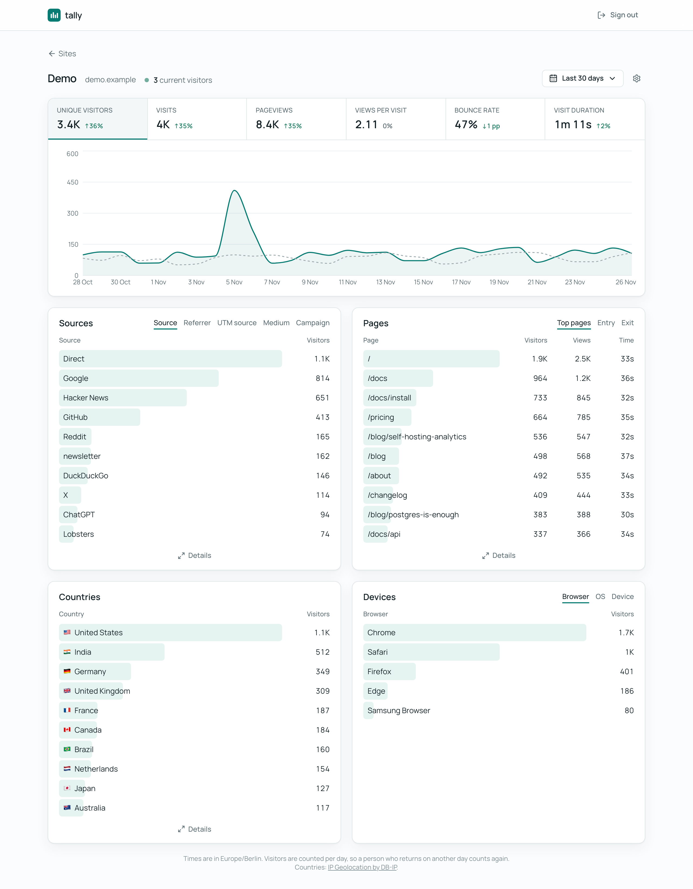
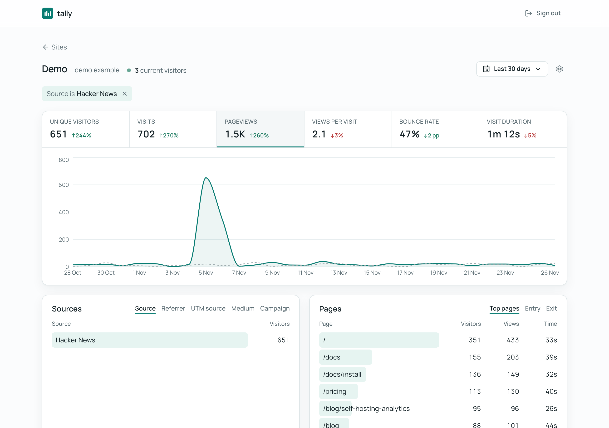
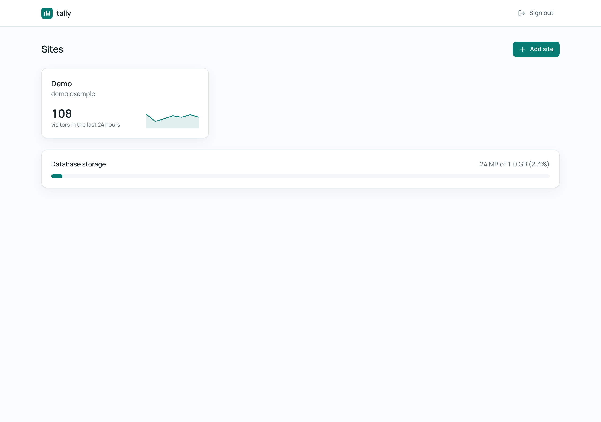

# tally

Self-hosted, cookie-free web analytics for your own projects. Paste one line into a site and see
its visitors, pages, sources, countries and devices on a private dashboard. No cookies, no stored
IP addresses, no consent banner.

<picture>
  <source media="(prefers-color-scheme: dark)" srcset="docs/screenshots/dashboard-dark.png">
  
</picture>

- **One line per site.** `<script defer src="https://a.example.com/s/k3j9x2a0bq.js"></script>`.
  The script is under 1 KB gzipped (about 800 bytes), follows single-page-app navigation, and
  measures the time a page is actually visible.
- **Private by design.** Visitors get a daily, per-site hash instead of a cookie; IP addresses are
  never written down. See [docs/privacy.md](docs/privacy.md), which your sites can link to.
- **The numbers you need.** Unique visitors, visits, pageviews, views per visit, bounce rate and
  visit duration, each compared with the previous period; top sources, referrers, campaigns, pages,
  entry and exit pages, countries, browsers, OSs and devices; click any row to filter by it;
  current visitors. Every view is a URL you can bookmark. See [docs/metrics.md](docs/metrics.md).
- **Small and cheap to run.** One Go binary and plain Postgres, no ClickHouse, Redis or queue.
  On Heroku and Vercel it costs about $12 a month for all your sites, up to roughly a million
  pageviews a month.

## Deploy

| The service (tracker, collector, API) | The dashboard |
|---|---|
| [](https://www.heroku.com/deploy?template=https://github.com/Gitax18/tally) | [](https://vercel.com/new/clone?repository-url=https%3A%2F%2Fgithub.com%2FGitax18%2Ftally&root-directory=web&project-name=tally-dashboard&env=API_URL,API_SECRET,SESSION_SECRET&envDescription=API_URL%20is%20the%20service%27s%20public%20URL%2C%20API_SECRET%20the%20same%20value%20as%20on%20Heroku%2C%20SESSION_SECRET%20any%2032%2B%20random%20characters&envLink=https%3A%2F%2Fgithub.com%2FGitax18%2Ftally%2Fblob%2Fmain%2Fdocs%2Fself-hosting.md%233-deploy-the-dashboard-to-vercel) |

Start with the service, then the dashboard. [docs/self-hosting.md](docs/self-hosting.md) walks
through both, including the password hash, a custom domain (which keeps ad blockers from blocking
`*.herokuapp.com`) and running it somewhere other than Heroku.

## How it works

```
your site ── <script defer src="https://a.example.com/s/{site}.js">   served by Go, cached 1 h
    │  POST /e   (sendBeacon, text/plain: no CORS preflight)
    ▼
Go service ──► Postgres          sessions + events, all times grouped in each site's time zone
    ▲  /v1/*   (Bearer API_SECRET, server to server)
    │
Next.js dashboard                 the browser never sees the secret
```

- The service serves the script itself, so it shares an origin with the event endpoint, sees the
  visitor's real IP (for the country and the hash, then discarded), and writes the site ID into
  the script: the snippet needs no attributes.
- Events are validated (known site, matching hostname, not a bot, under 2 KB, at most 30 per
  10 seconds per address), answered with `202` right away, and written by a single worker that
  owns all visit state, so visits never race. On shutdown it drains its queue first.
- Visitor ID = first 8 bytes of `SHA-256(daily salt ‖ site ‖ IP ‖ user agent)`. Salts are random,
  stored only in Postgres, and deleted after two days.
- The dashboard calls the service from server components and two small route handlers; its only
  state is a signed, httpOnly session cookie.

<details>
<summary>More screenshots</summary>

Filtered to one source, charting pageviews:



The details view of a panel, with search:


The sites list with the storage meter:



</details>

## API

Everything the dashboard shows comes from the service's JSON API, so you can script against it
too. Send `Authorization: Bearer $API_SECRET`.

| Endpoint | |
|---|---|
| `GET /v1/sites`, `POST /v1/sites` | List sites; add one (`name`, `domain`, `timezone`) |
| `GET`, `PATCH`, `DELETE /v1/sites/{id}` | One site |
| `GET /v1/sites/{id}/summary` | The six metrics, the previous period's, and the change |
| `GET /v1/sites/{id}/timeseries` | Every metric per hour, day or month (`interval`), with the previous period |
| `GET /v1/sites/{id}/breakdown` | Top values of a `dimension`, with `limit` (up to 1000) and `search` |
| `GET /v1/sites/{id}/realtime` | Visitors in the last 5 minutes |
| `GET /v1/usage` | Database size against `DB_LIMIT_MB`, and ingest counters |
| `GET /v1/timezones` | The time zones a site can use |

The stats endpoints take `period` (`today`, `yesterday`, `7d`, `30d`, `month`, `last_month`,
`12mo`, or `custom` with `from` and `to` as `YYYY-MM-DD`) and `filters`, such as
`filters=source:Google,country:IN` (values URL-encoded). Dimensions: `source`, `referrer`,
`utm_source`, `utm_medium`, `utm_campaign`, `page`, `entry_page`, `exit_page`, `country`,
`browser`, `os`, `device`, `hostname`.

```sh
curl -H "Authorization: Bearer $API_SECRET" \
  "https://a.example.com/v1/sites/k3j9x2a0bq/breakdown?period=7d&dimension=page&limit=5"
```

## Development

You need Go 1.27, Node 24 with pnpm, and Docker.

```sh
make db migrate seed   # Postgres on 127.0.0.1:5442, the schema, and a "Demo" site with 90 days of fake visits
make run               # the service on :8090
make web-dev           # the dashboard on http://localhost:3010, password: tally-dev-password
```

`examples/demo.html` is a multi-page, single-page-app test site for the tracker: add a site with
the domain `localhost`, serve `examples/` (for example `python3 -m http.server 8099 -d examples`)
and open `http://localhost:8099/demo.html?site=<id>&api=http://127.0.0.1:8090`.

| | |
|---|---|
| `make check` | `go vet`, golangci-lint, and all Go tests including the Postgres ones |
| `make tracker` | Rebuild `tracker/t.min.js` after editing `tracker/t.js` (a test fails above 1 KB gzipped) |
| `cd web && pnpm lint && pnpm typecheck && pnpm test` | Dashboard checks and unit tests |
| `cd web && pnpm build && pnpm test:e2e` | The end-to-end test: the whole stack in Chromium, from a visit to the dashboard |
| `cd web && node scripts/screenshots.mjs` | Recapture the screenshots above from the seeded demo site |

```
cmd/server, cmd/migrate   the service and the migration runner (Heroku's release phase)
internal/                 ingest, sessions, stats, filters, sites, auth, geo, retention, ...
migrations/               SQL, embedded in the binary
tracker/                  the tracking script, minified with esbuild and embedded
web/                      the Next.js dashboard
tools/seed                fake data for development
```

## Not in v1

Custom events and goals, public share links, outbound-link and download tracking, a weekly email,
CSV export, more than one user. The schema already has room for custom events.

## License

[MIT](LICENSE). Country data: [IP Geolocation by DB-IP](https://db-ip.com), CC BY 4.0.
